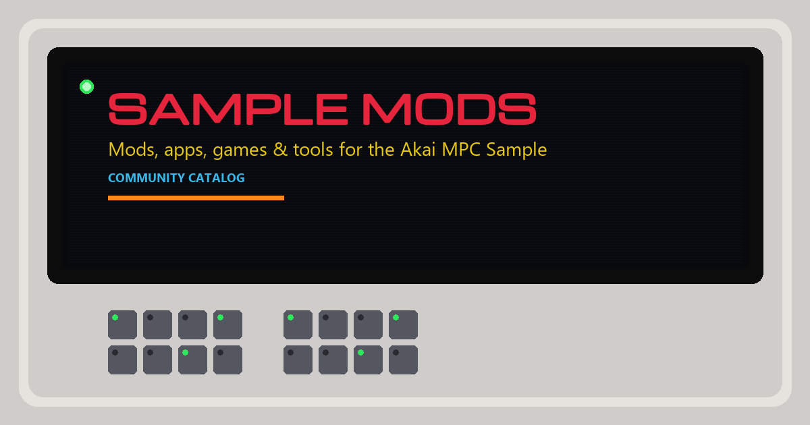

# Sample Mods

[](https://samplemods.com)

**[samplemods.com](https://samplemods.com)** is an independent, community-maintained catalog of mods, apps, games, tools, guides and developer resources for the Akai MPC Sample.

Not affiliated with or endorsed by Akai Professional / inMusic Brands.

## Contribute

There are two ways to contribute: a quick form, or a pull request.

| I want to… | Do this |
|---|---|
| Suggest a project | [Fill in the "Suggest a project" form](https://github.com/2wenty2wo/samplemods/issues/new?template=new-entry.yml) |
| Fix, update or remove a listing | [Fill in the "Fix or update a listing" form](https://github.com/2wenty2wo/samplemods/issues/new?template=change-entry.yml), or use **Suggest an edit** on any entry page |
| Edit the catalog files myself | Follow [CONTRIBUTING.md](CONTRIBUTING.md) and open a pull request |

The forms need a free GitHub account, and submissions are added to the catalog for you.

[Code of Conduct](CODE_OF_CONDUCT.md) · [Security policy](SECURITY.md) · [Accessibility](ACCESSIBILITY.md) · [Licence](LICENSE)

## How it works

- Each entry is a small YAML file in `data/<section>/<id>/`, with optional `logo.*` and `screenshots/` beside it.
- Sections: `mods`, `apps`, `games`, `tools`, `guides`, `dev`.
- GitHub stars, READMEs and releases are refreshed automatically every 6 hours for entries with a `repo`.
- The site is built with SvelteKit as a static site and deployed to GitHub Pages on every push to `main`.
- A public JSON feed of the catalog is published at [samplemods.com/catalog.json](https://samplemods.com/catalog.json).

## Run locally

Requires Node.js 24.

```sh
npm ci
npm run dev      # build catalog data, then start the dev server
npm test         # validate the catalog and run the script tests
npm run build    # production build to build/
```
