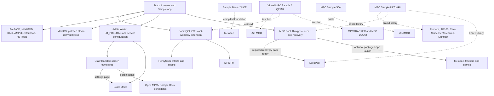

# MPC Sample catalog research

Research snapshot: **14 November 2026 (UTC)**. Research and recommendations only; no catalog, schema, code or routing changes made.

## Recommendation

Call an entry a **project**. Browse five sections: **Enhancements (11), Apps & games (11), Tools (4), Developer resources (4), Guides (3)**. Store records in flat `data/projects/<id>.yaml` and use category-independent `/projects/<id>/` detail URLs.

Classify behaviour, not the author's choice of “mod”, “OS”, “firmware” or “app”. The community uses these terms loosely. Explain the difference in one line:

> Enhancements add to the familiar Sample workflow; apps and games run their own workflow on the device.

Tools, developer resources and guides get their own shelves. Melodee explicitly replaces the stock application; SampQOL extends it. A stopped stock process, SD boot or splash labelled “OS” does not establish that system firmware was flashed. MaiaOS is a stock-derived hybrid requiring better working-screen evidence before stronger UI claims.

## Evidence and reading key

Reviewed all 33 READMEs, recursive HEAD file trees, repository metadata and up to three recent releases through GitHub's API. Also read selected release-ZIP launchers as text; no upstream programs were executed. Project links below lead to primary evidence; release/push dates support activity assessments.

- **Stock + extras** allows new/custom pages while retaining the stock application workflow. **Own UI** means a separate application/workflow, even when its graphics resemble the stock screens.
- **Not stated** is an evidence gap, not assumed compatibility. Versions documented by guides are not installation requirements. All 33 repositories reported `archived=false` at this snapshot.
- Maturity is an editorial assessment unless explicitly attributed. A v1 tag, recent push or star count alone does not certify stability. “Stable” here describes a published, documented artifact/reference, not a hardware safety guarantee.
- Licences describe the project's stated terms. Firmware, game data, dependencies and media can have different terms. GitHub SPDX detection misses custom/mixed licences.

## 1. Per-entry fact sheet

Activity dates below are **2026, UTC**; “push” is GitHub's repository `pushed_at`, not proof of a default-branch code change. UI claims refer to the linked README/screens unless noted otherwise.

| Project / primary evidence | What it is; relationship to stock UI | Runs where | Installation / stock return | Host / dependencies | Firmware stated | Audience | Maturity assessment + evidence | Licence | Activity |
|---|---|---|---|---|---|---|---|---|---|
| [MPC Sample Modding Kit](https://github.com/Daniel-Hillman/mpc-sample-agent-mod-guide#readme) | Research, safety notes, AI templates; no consumer device UI | Docs; optional desktop/device examples | Read notes; optional SSH experiments | Host computer and device access for examples | 1.3.0.12 research target | Developer, curious | Experimental research; findings from one unit, no product release | MIT code/templates; CC BY 4.0 docs | Push 11-03; no release |
| [Am MOD](https://github.com/AlekseyMalykh/am-mod#readme) | Sequencer/chords/EQ; stock + extras, shown in README captures | Device | SD autorun patches RAM copy; boot without card for stock | Stock app; not SampQOL | 1.3.0.12 only; hash checked | Musician | Stable assessment: README calls r28d previous stable; current r29a; FAT32 experimental | MIT own code; stock app separate | r29a 11-13; push 11-13 |
| [AZ0x Open Source Releases](https://github.com/inmusic-software/az0x-open-source#readme) | Official Linux source archives; no application UI | Desktop/source | Download relevant branch; no ready end-user install | inMusic Linux/BSP sources and build tools | MPC Sample 1.3.0 source branch | Developer | Stable archive: official versioned source drop, not playable firmware | Per-component licences; no umbrella licence | Push 11-09; no release |
| [Beat-Train](https://github.com/drose030/beat-train-mpc-sample#readme) | Drum rhythm game; own note-highway UI | Device | SD autorun; optional Boot Thingy coexistence; exit restores stock | Standalone program; Clone Hero-format songs | 1.3.0.x | Player, musician | Stable assessment: v1.6 package and documented gameplay/install | MIT; decoders separate | v1.6 11-07; push 11-07 |
| [Draw Handler](https://github.com/jacob-sabella/mpc-addin-sample-draw-handler#readme) | Stock-process screen service; full-screen plugin pages, then stock returns | Device | Root SSH + install.sh; LD_PRELOAD service drop-in; Sample persistence caveat | Stock addin loader; serves drawing clients | 1.3.0.12 tested; release requirements conflict [A] | Musician, developer | Experimental assessment: tested v1.0.1, contradictory target text [A] | MIT | v1.0.1 11-06; push 11-06 |
| [HenrySkillz Mod Kit](https://github.com/Holla-Back-Entertainment/henryskillz-mpc-sample-mod-kit#readme) | Effects/chains/utilities in stock workflow; added pages and styling | Device; browser installer | Browser assembles SD autorun; stock-only HS Tools alternative ZIP | SampQOL 0.2.0 for effects/chains; stock for HS Tools [B] | 1.3.0 / full 1.3.0.12 | Musician | Beta assessment: v0.6.1; v0.5 boot tested, newer features emulator-tested | MIT own code; SampQOL separate | v0.6.1 11-14; push 11-14 |
| [KAOSAMPLE](https://github.com/omarhuertasllc-ops/kaosample-beta#readme) | Looper, stem export, scales, EQ; explicitly adds to stock app | Device | SD autorun, RAM-only; remove autorun/boot without card for stock | Stock app; independent of SampQOL | 1.3.0.12; disables elsewhere | Musician | Beta: owner-labelled, hardware testing incomplete | Custom beta terms; no source; no re-upload stated | v0.35.1-beta 11-07; push 11-07 |
| [Koala MPC OS](https://github.com/rmw5287/koala-mpc-os) | Koala-style firmware ambition; UI/workflow not established | Device intended | No documented install/release | Unknown; no demonstrated Koala runtime compatibility | Not stated | Developer, curious | Concept-only assessment: blank README, main.cpp, no releases | Not stated | Push 11-09; no release |
| [Lightfoot](https://github.com/Dyldog/Lightfoot#readme) | MIDI rhythm game; own four-lane game UI | Device; desktop simulator | Build SD ZIP; optional Boot Thingy; Quit/Shift+Stop restores stock | Standalone game; UI Toolkit/TinyALSA at build time | 1.3.0.12 | Player, musician | Experimental assessment: simulator/build instructions and screenshots, no published release | MIT; submodules separate | Push 11-14; no release |
| [LoopPad](https://github.com/larsoholm/LoopPad#readme) | Live looper; own SETUP/LIVE interface | Device; desktop build | Build source; Boot Thingy required for supported launch/recovery | Boot Thingy runtime; UI Toolkit/TinyALSA build dependencies | Not stated | Musician, developer | Experimental: v0.6.0 development, no hardware exit; source-only [C] | MIT own code; pinned dependencies need review [C] | Push 11-05; no release |
| [MaiaOS](https://github.com/rosen-wav/MaiaOS---Mpc-Sample-CFW#readme) | Patched stock-derived app with new modes; hybrid UI extent unverified [D] | Device | SD autorun; rebuild RAM copy + temporary bind mount; no firmware flash [D] | Exact stock binary; bundled host/DSP libraries; not SampQOL | 1.3.0.12; release excludes 1.4 | Musician, developer | Beta: owner says first beta; source-preview ZIPs + beta binary | Mixed GPL/AGPL/MIT/etc.; inventory unfinished | beta 11-13; push 11-13 |
| [Melodee](https://github.com/keremimo/melodee-sample#readme) | 16-track groovebox; own track/pattern/scene workflow, explicitly replaces stock app | Device | SD autorun starts separate app; MPC APP exit restores stock | Sample Base/JUCE compiled in; optional ARM Linux plugins | 1.3.0.12; refuses others | Musician | Beta assessment: first full v0.1.0; not independently hardware-validated here | AGPL-3.0-only; fonts/dependencies separate | v0.1.0 11-12; push 11-12 |
| [MP DOOM](https://github.com/fomoPhil/mp-doom#readme) | Classic DOOM port; own game UI | Device | SD autorun, runs in memory; quit returns stock | Standalone port; shareware or own game data | 1.3.0.12 tested | Player | Stable assessment: v1.0.4, documented controls and stock return | GPL-2.0-or-later port/engine; game data separate | v1.0.4 11-08; push 11-08 |
| [MPC Boot Thingy](https://github.com/garrettjwilke/mpc-boot-thingy#readme) | Launcher/recovery utility; own menu, not music-workflow redesign | Device; browser management | USB test-app upload or SD autoboot folder; manages app ZIPs | Stock boot facilities; UI Toolkit; optional USB browser | Not stated in README/current release | Musician, player, developer | Beta assessment: active v1.1.5, documented install/recovery | No project-level licence found; dependencies separate | v1.1.5 11-14; push 11-14 |
| [MPC Cave Story](https://github.com/garrettjwilke/mpc-cavestory#readme) | Cave Story port; separate game/control UI | Device | SD autorun or Boot Thingy; launcher stops/restores stock [E] | doukutsu-rs + UI Toolkit; own Cave Story data | Not stated | Player | Experimental assessment: v1.0.0; README calls bindings awkward | Port licence unstated; upstream/game data separate | v1.0.0 10-31; push 11-02 |
| [MPC FM](https://github.com/ThomasTestaud/mpc-fm#readme) | FM pad source inside stock/SampQOL audio path; custom FM edit page | Device | Build SD launcher; chain official SampQOL autorun; preload FM module | SampQOL OS and stock filter/mixer/effects | 1.3.0.12 | Musician, developer | Experimental: explicitly prototype 0.2.0; new page not device-tested | No explicit project licence found; SampQOL excluded | Push 11-08; no release |
| [MPC Furnace](https://github.com/garrettjwilke/mpc-furnace) | Furnace tracker; own program/UI inferred from package and ui_views files [E] | Device | Released SD autorun ZIP or Boot Thingy; stops/restores stock [E] | Furnace + UI Toolkit submodules | Not stated | Musician | Experimental assessment: v1.0.0 artifact, no README | Port licence unstated; upstream licences separate | v1.0.0 10-31; push 11-01 |
| [MPC Gen1Recomp](https://github.com/garrettjwilke/mpc-gen1recomp#readme) | Pokemon game runtime; own game/settings UI | Device | SD autorun or Boot Thingy; load own ROMs [E] | Game runtime + UI Toolkit; user-supplied ROMs | Not stated | Player | Experimental assessment: v1.0.1; documented controls/ROM workflow | Port licence unstated; upstream/ROM rights separate | v1.0.1 11-11; push 11-11 |
| [MPC, Gently](https://github.com/slowphase/mpc-gently#readme) | Illustrated beginner handbook; no device UI | Docs/PDF | Read/download; nothing on device | PDF reader; no mod host | Documents 1.3; manual 1.3.0 RevA | Musician, curious | Beta assessment: v1.0.1; physical lesson walkthrough pending | CC BY-SA 4.0 original handbook/previews; MIT scripts; exclusions [F] | v1.0.1 11-11; push 11-11 |
| [MPC Sample MINIMOD](https://github.com/ioma8/mpc-minimod#readme) | Stock look/workflow plus AutoTrim, synth and looper pages | Device | SD autorun preloads mod; remove card/autorun for stock | Stock app; Rust SDK at build time | 1.3.0.12 only | Musician | Beta assessment: v0.9.0 and ongoing Rust development | No root licence found; SDK MIT does not establish mod licence | v0.9.0 11-12; push 11-13 |
| [MPC DOOM](https://github.com/jeffwebb-to/mpc-sample-doom#readme) | DOOM port; own game UI and LED health bar | Device | SD autorun stops sampler; quit restarts it | Standalone doomgeneric; Freedoom/own WADs | 1.3.0.12 tested | Player | Experimental: v1.0.0; sound effects not hardware-confirmed | GPL-2.0 project; Freedoom BSD; commercial WADs separate | v1.0.0 11-08; push 11-08 |
| [MPC Sample Export](https://github.com/savicreations/mpc-sample-export-downloads#readme) | XPJ audio/stem/MIDI exporter; desktop UI | Desktop: Windows x64 | Portable ZIP; export files, no device software | Windows; own XPJ/ProjectData files | No firmware requirement; limited project compatibility | Musician | Stable assessment: v1.0.0; owner's projects tested, other cases unproven | MIT claimed; source private, download repo only | v1.0.0 10-31; push 10-31 |
| [MPC Sample Kit](https://github.com/micknoise/mpc-sample-kit#readme) | Algorithmic drum/MIDI controller; no replacement device UI | Desktop CLI + browser | Computer tools/web page send USB-MIDI; no device mod | Chromium Web MIDI/File System Access; macOS CoreMIDI CLI | Not stated | Musician, developer | Experimental: README “early, but playing”; no releases | MIT; bundled browser dependencies separate | Push 08-28; no release |
| [MPC Sample SDK](https://github.com/ioma8/mpc-sample-sdk#readme) | Rust stock-app mod SDK; no end-user UI itself | Desktop build; device-linked code | Cargo/build tools; resulting mods can SD-boot/preload | Stock binary interfaces; Rust toolchain | 1.3.0.12 | Developer | Experimental assessment: current source API, no standalone release | MIT | Push 11-12; no release |
| [MPC Sample Secrets](https://github.com/c1t1zen1/MPC-Sample-Secrets#readme) | Interactive control/shortcut/research reference | Browser/docs | Visit site; no device install | Browser; manuals/community evidence | Reference sync 1.3.0 / build 1.3.0.12 | Musician, curious, developer | Stable reference assessment: published searchable site; evidence-labelled claims | No explicit project licence found | Push 10-31; no release |
| [MPCTRACKER](https://github.com/jeffwebb-to/mpc-sample-tracker#readme) | Eight-track pattern tracker; own editor/browser UI | Device | SD autorun; independent program; quit restarts sampler | Standalone C tracker; WAV samples/ProTracker MOD | 1.3.0.12 | Musician | Experimental: v0.1.0; starts/plays on hardware, broader testing pending | MIT | v0.1.0 11-10; push 11-10 |
| [MPC Stemloop](https://github.com/pzuzarte/mpc-stemloop#readme) | Offline AI splitter in stock selected-pad workflow | Device | SD autorun + module/model; Shift+DATA on selected pad | Stock app; ONNX Runtime/Demucs model; not SampQOL | 1.3.0.12 | Musician | Experimental assessment: v0.1.1; short-loop limits, limited validation evidence | No umbrella licence found; model/runtime terms separate | v0.1.1 11-11; push 11-11 |
| [MPC TIC-80](https://github.com/garrettjwilke/mpc-tic80) | TIC-80 runtime; own program UI inferred from package/ui_overlay [E] | Device | SD autorun ZIP or Boot Thingy; stops/restores stock [E] | TIC-80 + UI Toolkit; game cartridges | Not stated | Player | Experimental assessment: v1.0.0 artifact, no README | Port licence unstated; engine/cartridges separate | v1.0.0 10-31; push 11-01 |
| [MPC Sample UI Toolkit](https://github.com/garrettjwilke/mpc-ui-toolkit#readme) | C drawing/widget library; demo UIs, not consumer music workflow | Desktop build; device library/demos | Link into programs; optional demos via Boot Thingy | AArch64 Linux/DRM; surface interfaces; Zig C toolchain | Not stated | Developer | Experimental assessment: v1.0.0 demos; evolving API | CC0-1.0 toolkit; font/third-party terms separate | v1.0.0 10-24; push 11-10 |
| [Sample Base](https://github.com/keremimo/sample-base#readme) | Standalone JUCE application foundation; own demo UI | Desktop build; device runtime | SD demo ZIP or SSH; app replaces stock for session, exit restores it | JUCE 9 + existing device drivers; not SampQOL | 1.3.0.12 exactly | Developer | Experimental: v0.1.0 release described as proof of concept | AGPL-3.0-only; JUCE/other notices separate | v0.1.0 11-11; push 11-12 |
| [SampQOL OS](https://github.com/snarebes/SampQOL-OS#readme) | Stock UI plus tracks/sequencer/mixer/chop extensions | Device | SD autorun; stock-app extension; boot without card for stock | Stock app; host for some add-ons | 1.3.0 / full 1.3.0.12 tested | Musician | Beta: explicit README warning; v0.2.0 conflicts with catalog stable badge | Custom freeware, closed source; redistribution restricted [F] | v0.2.0 11-08; push 11-09 |
| [Scale Mode](https://github.com/jacob-sabella/mpc-addin-sample-scalemode#readme) | Stock 16 Levels repitched; custom settings page, not complete app | Device | Root SSH install.sh; preload; volatile Sample drop-in, reinstall after boot | Stock addin loader; Draw Handler for page; not SampQOL | 1.3.0.12 hardware checked | Musician | Beta assessment: v1.2.0; hardware checks, persistence caveat | MIT | v1.2.0 11-10; push 11-10 |
| [Virtual MPC Sample](https://github.com/orrpunk-art/virtual-mpc-sample#readme) | Real stock firmware in QEMU; browser panel reproduces stock UI | Desktop backend + browser | Local emulator setup + own firmware; no physical-device install | QEMU; macOS/Linux/Windows claimed, Windows untested | 1.3.0.12 image | Developer, curious | Experimental: working emulator; Windows run/USB audio pending | MIT project; Akai firmware/content not included or relicensed | Push 11-01; no release |

### Evidence notes and conflicts

**[A] Draw Handler is a screen service, not the addin loader.** Loading uses `LD_PRELOAD` and a service drop-in. Its README describes the Sample and a volatile `/run` installation. The [v1.0.1 release](https://github.com/jacob-sabella/mpc-addin-sample-draw-handler/releases/tag/sample-draw-handler-addin-v1.0.1) lists generic Gen2 requirements omitting the Sample, yet its footer explicitly reports Sample 1.3.0.12 hardware testing. This is a documentation inconsistency, not proof of incompatibility; check the actual package target before offering an Install action. Scale Mode credits SampQOL but says they hook the same functions and have not been tested together: attribution is not a runtime dependency. Its page needs Draw Handler; earlier release notes say scale toggling itself can work without the page.

**[B] HenrySkillz has conditional requirements.** Effects/chains require official SampQOL 0.2.0; the separate HS Tools ZIP runs on stock. Current project-wide `requires: [sampqol-os]` is too broad for the entire repository. Keep one project, explain package-specific requirements, and avoid implying all features work on stock. [README](https://github.com/Holla-Back-Entertainment/henryskillz-mpc-sample-mod-kit#readme).

**[C] LoopPad is source-only and needs a recovery path.** It has no implemented hardware exit/power handler, so its supported workflow requires Boot Thingy. Its README also says its pinned UI Toolkit lacked a licence. Toolkit HEAD now has [CC0-1.0](https://github.com/garrettjwilke/mpc-ui-toolkit/blob/main/LICENSE), which does not establish the rights for the pinned revision. Do not declare that upstream blocker resolved without checking the revision. [LoopPad](https://github.com/larsoholm/LoopPad#readme).

**[D] MaiaOS is stock-derived, not evidence of system flashing.** In the [beta ZIP](https://github.com/rosen-wav/MaiaOS---Mpc-Sample-CFW/releases/tag/beta), `autorun/maia-start.sh` validates a stock hash, creates a patched executable under `/run`, temporarily bind-mounts it over the executable path and starts RAM-staged libraries. This was read, not run. Its release explicitly excludes 1.4. The expanded modes are documented; a splash is insufficient evidence of a wholly new main UI. Provisional placement: Enhancements, marked hybrid. Request representative working screens before claiming the opposite. Today's root tree holds source-preview ZIPs; some README source/manual links point to paths inside those archives rather than loose root files.

**[E] The small ports are standalone programs even when called mods.** Furnace, TIC-80, Cave Story and Gen1Recomp release ZIPs contain `autorun.sh` launchers that stop `ac50.service`, start their program and restart stock afterwards; an alternate path handles Boot Thingy. [Furnace release](https://github.com/garrettjwilke/mpc-furnace/releases/tag/v1.0.0), [TIC-80](https://github.com/garrettjwilke/mpc-tic80/releases/tag/v1.0.0), [Cave Story](https://github.com/garrettjwilke/mpc-cavestory/releases/tag/v1.0.0), [Gen1Recomp](https://github.com/garrettjwilke/mpc-gen1recomp/releases/tag/v1.0.1). UI files/engine submodules support the own-UI inference for the two README-less projects. Optional Boot Thingy support is not a mandatory runtime dependency for every port.

**[F] Free to download does not establish open-source or mirroring rights.** SampQOL's [custom licence](https://github.com/snarebes/SampQOL-OS/blob/main/LICENSE) covers scripts, splash, added screens and manual, and requires written permission for redistribution. The lead removed its mirrored media in commit `a0cd015` during this research; this report changes no assets. [MPC, Gently](https://github.com/slowphase/mpc-gently/blob/main/LICENSE.md) distinguishes original handbook/previews (CC BY-SA 4.0), scripts (MIT), fonts and excluded Akai artwork/hero. Do not derive all media rights from one SPDX label.

Other catalog corrections suggested by the evidence: SampQOL's “stable” badge conflicts with its beta README; the agent Modding Kit is primarily a guide; Virtual MPC Sample is a tool/test bed; Sample Base/UI Toolkit demos do not change their primary role as developer resources; MPCTRACKER documents WAV/MOD rather than the metadata's broad XM/IT wording. No records were changed in this research task.

## 2. Ecosystem map

Solid arrows are runtime/platform relationships; dotted arrows are build/test relationships. Optional launcher support is not proof that all combinations have been tested together.

Sample Base supplies a standalone app's hardware/audio/lifecycle. The Rust SDK targets stock-app modifications. UI Toolkit supplies drawing/input widgets to standalone programs. These are different development paths, not competing firmware downloads. Their build ancestry belongs in “Built with” notes, not a musician's compulsory `requires` list. [Sample Base](https://github.com/keremimo/sample-base#readme), [SDK](https://github.com/ioma8/mpc-sample-sdk#readme), [UI Toolkit](https://github.com/garrettjwilke/mpc-ui-toolkit#readme).

Standalone programs still use the stock system/kernel: replacing an application for a session differs from replacing firmware. USB-MIDI tools such as Sample Kit communicate with the device externally. Guides and source archives do not need a mod runtime.

## 3. How visitors think

| Visitor question | Main path | Projects answering it | Information needed before acting |
|---|---|---|---|
| “Can I improve the familiar Sample workflow?” | Enhancements | SampQOL, Am MOD, MINIMOD, KAOSAMPLE, MaiaOS; HenrySkillz, MPC FM, Scale Mode, Draw Handler, Stemloop | Exact firmware, stock-derived versus standalone, required host, package-specific prerequisites, SD/SSH route and recovery. Keep concept-only Koala visibly separate from installable projects. |
| “What else can I make music with or play on the box?” | Apps & games | Melodee, MPCTRACKER, Furnace, LoopPad; Beat-Train, Lightfoot, both DOOM ports, Cave Story, Gen1Recomp, TIC-80 | Independent workflow, required song/game data, install and exit path; optional Boot Thingy versus LoopPad's currently required recovery. |
| “I want to build or investigate something.” | Developer resources; relevant Tools/Guides | SDK, UI Toolkit, Sample Base, AZ0x sources; Virtual MPC Sample, Boot Thingy, Modding Kit | Stock-app hooks versus standalone development; build platform, licences, emulator limits and source-only status. |
| “I want to learn the device or prepare/manage my music.” | Guides + Tools | MPC, Gently; Secrets; Modding Kit for technical users; Sample Export, Sample Kit, Virtual MPC Sample | Beginner versus technical audience; browser/desktop/device badges; export compatibility; no device installation for a book or Windows exporter. |

## 4. Comparable catalogs

| Catalog | Observed separation | Worth copying |
|---|---|---|
| [The Firmware Hub](https://thefirmwarehub.com/) / [Tools](https://thefirmwarehub.com/tools/) | Device firmware is distinct from emulators, editors, rescue/build tools and the Knowledge Base. Beta/licence distinctions are visible; some projects are link-only. | Separate purpose, device/host and installation context. Its flashing-first model does not describe our SD/RAM extensions. |
| [MeshCore Ninja](https://meshcore.ninja/) / [Software](https://meshcore.ninja/software/) | Networks, devices, firmware and software are separate top-level types; software has client/utility/library/SDK filters. | Neutral ecosystem language and useful facets. Avoid importing its whole multi-device schema into a small single-device catalog. |
| [Playdate Catalog](https://play.date/games/) / [Develop](https://play.date/dev/) | Consumer games/apps are distinct from SDKs, programming documentation and education. Consumer browsing uses genres and an Apps category. | Give musicians/players a consumer shelf and builders their own entry point. Do not call development tools games. |
| [Flipper Apps Catalog](https://github.com/flipperdevices/flipper-application-catalog) / [official app docs](https://docs.flipper.net/zero/apps) | App manifests are distinct from source code and catalog documentation/tooling; companion clients manage installation and compatibility. | Preserve source/manifest provenance, version and compatibility, while exposing the installation/launch context. Do not imply every Sample project shares one loader. |

The direct `apps.flipper.net` front end could not be fetched with the research tool; its official documentation and catalog repository were available. These comparisons inform navigation, not MPC Sample compatibility claims.

## 5. Proposed taxonomy

### Five shelves, behaviour first

| Section / key | Count | Inclusion rule |
|---|---:|---|
| Enhancements / `enhancements` | 11 | Keep or extend the Sample workflow, including host-specific add-ons; mark hybrids and concepts explicitly. |
| Apps & games / `apps` | 11 | Separate music programs and games with their own workflow on the device. |
| Tools / `tools` | 4 | Launch, emulate, export or control; can run on-device or on another computer. |
| Developer resources / `developers` | 4 | SDKs, reusable libraries/application foundations and official platform sources. |
| Guides / `guides` | 3 | Learn controls, production techniques or modding; examples do not make a guide an SDK. |

Use **project/projects** site-wide: “33 projects”, “Browse projects”, “Submit a project”. Each project has one main shelf; runtime, audience, host and maturity are facets. A repository can have a browser installer or multiple packages without becoming several catalog entries.

Enhancements includes small additions and substantial stock-derived changes. Add a “Needs another project” filter for SampQOL add-ons rather than an overlapping top-level shelf. Apps & games includes both complete alternative music workstations such as Melodee and programs launched for a session such as trackers/games. Their independent workflow is the shared behaviour. “External” should be a runtime badge, not the definition of every tool: Boot Thingy runs on the device.

**Alternative, not recommended now:** split Add-ons into a sixth section if the group outgrows host filtering. Section-specific detail URLs would create taxonomy-dependent address changes.

### URL scheme and data layout

1. Canonical detail: **`/projects/<unchanged-id>/`**. Browsing pages can use `/enhancements/`, `/apps/`, `/tools/`, `/developers/`, `/guides/` or equivalent section filters. One project still has one canonical detail page.
2. Section-prefixed detail paths convey context but change when classification changes. Neutral descriptive URLs plus specific page titles and section breadcrumbs preserve context without an unsupported SEO ranking promise.
3. Preserve existing `/mod/<id>` links. On static GitHub Pages, generate legacy pages with canonical new URLs, visible links and redirect behaviour. These are **HTML redirects, not server-side 301s**. Use the custom 404 lookup only as a fallback for unexpected variants; verify base paths, custom domain and slash forms during migration.
4. Move records to **flat `data/projects/<id>.yaml`**, with a `section` field. Keep IDs and media locations stable. Per-section directories turn classification changes into file moves and require recursive discovery/ref validation across several scripts.
5. A later migration must change validation, data compilation, enrichment, star-list comparison, schema, public catalog URLs, detail-route generation and contribution instructions together. This report performs none of those changes.

### Schema changes

| Field | Proposed meaning / values | Why |
|---|---|---|
| `section` | Required enum: `enhancements, apps, tools, developers, guides`; replaces top-level `category` | One shelf follows visitor purpose. Retain the old category only during migration, not as a competing permanent classification. |
| `runs_on` | Array: `device, desktop, browser, docs` | A browser installer is not the runtime of the installed mod. Virtual MPC Sample has a desktop backend and browser frontend. |
| `device_mode` | Optional enum: `stock-extension, standalone, hybrid, unknown` | Behaviour remains explicit regardless of “OS/mod/app” branding. Screenshot styling alone does not prove the process/workflow model. |
| `host` + existing `requires` | Optional runtime host labels such as stock app, standalone, SampQOL/addin system; `requires` stays references to always-required projects | Keep build-time SDK/JUCE/toolkit ancestry separate. Describe conditional package requirements in a short note; HS Tools must not inherit a blanket SampQOL requirement. |
| `audience` | Optional array: `musician, player, developer, curious` | Find games and beginner guidance without multiplying top-level sections. |
| `status` | Existing values plus `concept-only`; unknown remains unknown when unreviewed | A blank concept repository and a published SD package should not appear equally installable. Record evidence/date for editorial judgments. |
| Installation/compatibility notes | Extend installation choices to cover SSH, Boot Thingy, desktop and browser, with multiple routes where documented | Current `install` mixes installation and USB-MIDI transport, and cannot accurately describe addins. Preserve exact firmware strings and explain tested/required/unsupported versions. |

Start with section/runtime/maturity and short evidence notes; do not build a package manager. Keep build ancestry, optional launchers, licence caveats and package exceptions in linked prose until filtering needs more structure. Derive “needs a computer” from installation requirements, not runtime alone. Allow curated licence notes alongside automated SPDX detection.

### All 33 placements

| Unchanged ID | Project | New section | Reason / secondary facet |
|---|---|---|---|
| `agent-mod-guide` | MPC Sample Modding Kit | Guides | Primarily research/instructions/templates; advanced developer audience. |
| `am-mod` | Am MOD | Enhancements | Stock application and workflow with added features. |
| `az0x-open-source` | AZ0x Open Source Releases | Developer resources | Official platform/compliance source archive, not ready-to-install firmware. |
| `beat-train` | Beat-Train | Apps & games | Independent drum rhythm game. |
| `draw-handler` | Draw Handler | Enhancements | Stock-process service enabling plugin/addin screen pages. |
| `henryskillz-mod-kit` | HenrySkillz Mod Kit | Enhancements | Effects/chains need SampQOL; HS Tools can use stock. |
| `kaosample` | KAOSAMPLE | Enhancements | Adds tools to the stock application. |
| `koala-mpc-os` | Koala MPC OS | Enhancements | Provisional concept placement; device behaviour not demonstrated. |
| `lightfoot` | Lightfoot | Apps & games | Independent rhythm game; desktop simulator is secondary. |
| `looppad` | LoopPad | Apps & games | Own looping workflow; Boot Thingy required for supported recovery. |
| `maiaos` | MaiaOS | Enhancements | Provisional stock-derived hybrid; verify representative working UI. |
| `melodee-sample` | Melodee | Apps & games | Independent groovebox workflow; Sample Base compiled in. |
| `mp-doom` | MP DOOM | Apps & games | Independent DOOM game program. |
| `mpc-boot-thingy` | MPC Boot Thingy | Tools | Device launcher/recovery utility; not a music-workflow redesign. |
| `mpc-cavestory` | MPC Cave Story | Apps & games | Independent game port. |
| `mpc-fm` | MPC FM | Enhancements | Adds FM sound sources inside the SampQOL/stock path. |
| `mpc-furnace` | MPC Furnace | Apps & games | Independent tracker program. |
| `mpc-gen1recomp` | MPC Gen1Recomp | Apps & games | Independent game runtime; requires user ROMs. |
| `mpc-gently` | MPC, Gently | Guides | Beginner handbook. |
| `mpc-minimod` | MPC Sample MINIMOD | Enhancements | Explicitly retains the original Sample experience. |
| `mpc-sample-doom` | MPC DOOM | Apps & games | Independent DOOM port; remains distinct from MP DOOM. |
| `mpc-sample-export` | MPC Sample Export | Tools | Windows project/audio converter; no device installation. |
| `mpc-sample-kit` | MPC Sample Kit | Tools | Host computer/browser MIDI control. |
| `mpc-sample-sdk` | MPC Sample SDK | Developer resources | Rust foundation for stock-app mods. |
| `mpc-sample-secrets` | MPC Sample Secrets | Guides | Interactive reference and learning resource. |
| `mpc-sample-tracker` | MPCTRACKER | Apps & games | Separate pattern-tracker workflow. |
| `mpc-stemloop` | MPC Stemloop | Enhancements | Stem splitting in the stock selected-pad workflow. |
| `mpc-tic80` | MPC TIC-80 | Apps & games | Independent fantasy-console runtime. |
| `mpc-ui-toolkit` | MPC Sample UI Toolkit | Developer resources | Reusable library; packaged examples are secondary. |
| `sample-base` | Sample Base | Developer resources | Standalone app foundation; demos are examples. |
| `sampqol-os` | SampQOL OS | Enhancements | Stock look/workflow extended with tracks and tools. |
| `scalemode` | Scale Mode | Enhancements | Extends stock 16 Levels; Draw Handler supplies the page. |
| `virtual-mpc-sample` | Virtual MPC Sample | Tools | Desktop/browser emulator; also linked from developer resources. |

## 6. Missing projects: candidates, not additions

Compared repository identities against the live **mpc-sample star list**. The completed daily-check dry-run found it identical to today's 33 catalog records: missing 0, extra 0. Searched GitHub for `"mpc sample"`, `mpc-sample`, `"akai mpc sample"` and the [mpc-sample topic](https://github.com/topics/mpc-sample), then checked candidate READMEs. Also followed [Secrets' network index](https://c1t1zen1.github.io/MPC-Sample-Secrets/sources.html), Boot Thingy's app links and [Open MPC](https://open-mpc.github.io/).

Generic model-predictive-control/multiparty-computation hits, forks without distinct value and unrelated browser drum pads were excluded. This is a discovery snapshot, not an exhaustive census.

| Candidate / primary evidence | What it is | Why it fits / proposed shelf |
|---|---|---|
| [Open MPC plugin toolchain](https://github.com/open-mpc/mpc-vst-plugins) | Native MPC plugin build/distribution tools, with Sample-specific page support and compatibility docs. | Developer resources; missing ecosystem platform. Link [Sample-targeting guidance](https://github.com/open-mpc/mpc-vst-plugins/blob/main/docs/MPC_SAMPLE.md), not a promise that every general MPC plugin works on Sample. |
| [MPC Sample Rack](https://github.com/jacob-sabella/mpc-addin-sample-rack) | Add/remove/disable insert plugins through the Sample RACK page and project edits. | Enhancements; directly complements Draw Handler, required for its page. |
| [Temporary root SSH](https://github.com/orrpunk-art/mpc-sample-root-ssh) | SD-autorun USB SSH with personal keys and documented 1.3.0.12 hardware checks. | Tools; access prerequisite for existing SSH-installed addins. |
| [MPC Sample Lab](https://github.com/gospodindilly-ops/mpc-sample-lab/blob/main/README.en.md) | Hardware/panel/audio research and RAM-launched Sample Mode experiments. | Developer resources; primary research base. Expose its application experiments as secondary features. |
| [MPC Sample Toolkit / MPCTK](https://github.com/tarikcampos/MPC-Sample-Toolkit) | Python CLI and desktop XPJ editor/generator for instruments and pad layouts. | Tools; README reports generated projects loaded and played on hardware. |
| [WorldLinkStudio MPC Sample](https://github.com/WorldLinkStudio/mpcsample) | Browser/Electron kit builder, sample preview and XPJ export. | Tools; off-device workflow, not a firmware mod or actual-firmware emulator. |
| [Le Resampler](https://github.com/flug/Le-Resampler) | Desktop sample-library manager with preview, tags and SD-folder export. | Tools; physical-sampler preparation. Confirm device-specific export expectations before featuring it. |
| [MPC2Live](https://github.com/Duffman007/MPC2Live) | MPC-project to Ableton Live Set converter; current downloads moved to Ko-fi. | Tools; GitHub remains a provenance/update link. Review current pricing/terms before listing. |
| [Trackyard](https://github.com/drose030/trackyard) | Computer-based drum separation and song-chart generation/editor for Beat-Train and Clone Hero. | Tools; supplies content for a game already cataloged. |
| [MPC Grid](https://github.com/pzuzarte/mpc-grid) | Browser sequencer with USB-MIDI playback and XPJ sequence export; states 1.3.0.12 testing. | Tools; musician value without modifying device firmware. |

None was added to the star list or catalog. Since the user's star list is the inclusion source of truth, review/star these first; the daily missing-project issue then identifies them. Community references support discovery rather than automatic endorsement.

## 7. MEDIA LICENCE AUDIT

Scope: the **15 remaining projects / 48 hosted files** listed in `data/media-sources.json` after SampQOL's removal. Checked root licences, README scope statements, relevant NOTICE/CREDITS/THIRD_PARTY files and hosted image contents. The table separates a repository licence from the particular image rights it can grant. Verdicts are proposed publication decisions, not edits made by this research.

The working rules are grounded in publisher terms:

- **No licence means copyright is reserved by default.** GitHub's permission to view/fork a public repository does not grant an unrelated website a general redistribution licence. [GitHub licensing guidance](https://docs.github.com/en/repositories/managing-your-repositorys-settings-and-features/customizing-your-repository/licensing-a-repository).
- **MIT can permit distribution of covered software/documentation**, but requires retaining the copyright and permission notice. A source URL alone is not that notice. Apache/BSD also have notice requirements when applicable; none of these licences grants rights the publisher does not own. [MIT terms](https://choosealicense.com/licenses/mit/).
- **GPL/AGPL code is not automatically a licence for screenshots.** Output can contain separately copyrighted artwork/input; displayed program artwork may itself be a covered work. Establish the image's scope, then carry its applicable licence/notices and any required source, rather than assuming that running an open-source renderer makes every pixel reusable. [FSF output guidance](https://www.gnu.org/licenses/gpl-faq.en.html#WhatCaseIsOutputGPL).
- **CC BY-SA covers the named material**, with credit, licence link and change indication; adaptations retain compatible ShareAlike terms. Excluded logos/art are not brought under CC merely by appearing on the same page. [CC BY-SA 4.0 terms](https://creativecommons.org/licenses/by-sa/4.0/).

“Keep but add a licence notice” below relies on the root MIT grant covering the project's own associated documentation/assets, with no separate exclusion found. It is not a blanket clearance of third-party interfaces or artwork. “Ask the author” means asset-specific scope remains unresolved; use a text/initials card rather than continue mirroring the unresolved file while waiting.

| Hosted project (file count) | Repo licence and primary evidence | Image scope / redistribution finding | Verdict and action |
|---|---|---|---|
| `am-mod` (4) | [MIT](https://github.com/AlekseyMalykh/am-mod/blob/main/LICENSE); [NOTICE](https://github.com/AlekseyMalykh/am-mod/blob/main/NOTICE.md) | Own splash has a plausible MIT grant. NOTICE explicitly says screenshots/GIFs show the stock app for documentation; it does not grant Akai's rights. `02-overview`, `03-chords`, `04-steps` need that distinction. | **Ask the author** for the stock-app captures/third-party scope. Own `01-am-mod-splash` can **keep but add a licence notice** with AM Mod contributors' copyright. |
| `beat-train` (2) | [MIT](https://github.com/drose030/beat-train-mpc-sample/blob/main/LICENSE) | `01-library` and `02-pad-setup` document the project's own game UI; no separate image exclusion found. No song audio is copied in these image files. | **Keep but add a licence notice**: preserve drose's copyright and full MIT notice, plus source/image credits. |
| `draw-handler` (3) | [MIT](https://github.com/jacob-sabella/mpc-addin-sample-draw-handler/blob/main/LICENSE) | These show Stompbox, Keyscope and Tuner plugin pages. A screen broker's code licence does not by itself establish the rights to each plugin's displayed art. No asset-specific permission found. | **Ask the author** which plugin/image licences apply to all three captures and obtain a media grant/necessary notices. |
| `henryskillz-mod-kit` (4) | [MIT](https://github.com/Holla-Back-Entertainment/henryskillz-mpc-sample-mod-kit/blob/main/LICENSE); [third-party notices](https://github.com/Holla-Back-Entertainment/henryskillz-mpc-sample-mod-kit/blob/main/THIRD_PARTY_NOTICES.md) | README describes HenrySkillz **code** as MIT and explicitly separates SampQOL. Own splash/art and captures of SampQOL-based mixer/effect/stem pages are not automatically one MIT media grant. | **Ask the author**, naming `01-henryskillz-splash`, `02-graphic-mixer`, `03-hs-effects-list`, `04-stems-chooser`; obtain any needed SampQOL permission separately. |
| `lightfoot` (4) | [MIT](https://github.com/Dyldog/Lightfoot/blob/main/LICENSE); [README](https://github.com/Dyldog/Lightfoot#readme) | README says these screens are rendered by its own simulator. Own game UI; no separate screenshot exclusion found. | **Keep but add a licence notice**: Dylan Elliott copyright, MIT text, image source credit. |
| `maiaos` (1) | **None for this asset**; [README mixed-component credits](https://github.com/rosen-wav/MaiaOS---Mpc-Sample-CFW#readme) | `01-splash.png` came from a release ZIP. Component GPL/MIT/AGPL credits do not grant rights to the cat/splash illustration; no licence for it found. | **Remove** from publication until explicit rightsholder permission or an image licence is supplied; ask for a licensed replacement. |
| `melodee-sample` (5) | [AGPL-3.0-only](https://github.com/keremimo/melodee-sample/blob/main/LICENSE); [THIRD_PARTY](https://github.com/keremimo/melodee-sample/blob/main/THIRD_PARTY.md) | Explicit carve-out: boot logo and city backdrop are all rights reserved. Hosted `logo.png` is a wordmark from docs, not the boot source file, so equivalence/scope must be confirmed; the four working-screen captures also lack a separate screenshot grant. | **Ask the author** specifically about docs wordmark and `stage/patterns/looper/song` captures. Do not infer permission for reserved boot art from the AGPL badge. For confirmed covered media, include its notices/licence and required source links/files. |
| `mpc-boot-thingy` (1) | **None** for project/splash; [tree](https://github.com/garrettjwilke/mpc-boot-thingy) | No root project/asset grant found. A bundled xterm dependency's licence cannot license the 320×240 splash or its device illustration. | **Remove** until splash-specific permission/licensing is recorded. |
| `mpc-gently` (3) | GitHub `NOASSERTION`; actually [CC BY-SA 4.0 original book/previews + MIT scripts](https://github.com/slowphase/mpc-gently/blob/main/LICENSE.md); [credits/exclusions](https://github.com/slowphase/mpc-gently/blob/main/CREDITS.md) | Original preview pages/simplified lesson schematics are expressly covered: `02-controls-diagram` and `03-shaping-sound` fit that scope. `01-look-inside` includes MPC Sample logo lettering; excluded Akai artwork retains separate rights. Excluded `hero.jpg` is not hosted here. | **Keep with attribution** for the original covered preview material: title, slowphase, CC link, source, unchanged/adapted status. **Ask the author** about the excluded inset/logo in `01-look-inside`, or use only cleared pages. |
| `mpc-minimod` (4) | **None** at project root; [tree/README](https://github.com/ioma8/mpc-minimod) | No explicit licence for its four screenshots. The MIT SDK is a dependency; it cannot license these mod/UI images. | **Remove** until the author grants screenshot reuse or supplies licensed media. |
| `mpc-sample-doom` (5) | [GPL-2.0](https://github.com/jeffwebb-to/mpc-sample-doom/blob/main/LICENSE); [README licence/game-data split](https://github.com/jeffwebb-to/mpc-sample-doom#readme) | README's GPL statement names code/scripts, while game scenes use separately BSD-licensed Freedoom data. Docs logo/splash permission is not explicitly stated. GPL engine licensing alone does not clear every hosted image. | **Ask the author** to confirm `logo.svg`, splash and capture rights/game-data identity. For cleared scenes retain Freedoom BSD notices; for GPL-covered art include GPL/copyright and any required source. Never substitute commercial WAD screenshots without separate review. |
| `mpc-sample-export` (1) | [MIT](https://github.com/savicreations/mpc-sample-export-downloads/blob/main/LICENSE) | Public download repo includes its icon and MIT licence; no asset carve-out found. This is a plausible grant for the project's own associated icon, despite private application source. | **Keep but add a licence notice**: made by savi copyright + full MIT notice and original icon link. Record future asset-specific opt-in if available. |
| `mpc-sample-tracker` (4) | [MIT](https://github.com/jeffwebb-to/mpc-sample-tracker/blob/main/LICENSE) | Own tracker/intro/documentation captures; no separate exclusion found. Do not assume a sample's musical licence would be covered, but no audio is distributed here. | **Keep but add a licence notice**: Jeff Webb copyright + MIT text and screenshot credits. |
| `scalemode` (3) | [MIT](https://github.com/jacob-sabella/mpc-addin-sample-scalemode/blob/main/LICENSE) | Original SCALE page documented by its screenshots; no asset carve-out found. This is distinct from mirroring SampQOL screens credited as inspiration. | **Keep but add a licence notice**: Jacob Sabella copyright + MIT text and source credits. |
| `virtual-mpc-sample` (4) | [MIT](https://github.com/orrpunk-art/virtual-mpc-sample/blob/main/LICENSE); [README legal section](https://github.com/orrpunk-art/virtual-mpc-sample#readme) | Three are captures of Akai's stock app; the panel image combines emulator layout/device appearance. README says stock screenshots serve documentation/interoperability, not that Akai artwork is MIT-licensed. | **Ask the author** for image-specific ownership/licensing and third-party scope; prefer an explicitly cleared original emulator illustration if stock captures cannot be cleared. |

### Recommended site-wide policy

1. **Mirror only asset-level cleared media.** Accept a clear image licence or an explicit permission permalink identifying the exact files and rightsholder. No licence/unclear scope means a normal repository link and initials/text card. A browser hotlink is not a reliable permission substitute and adds an external visitor request, so do not treat hotlinking as automatic clearance.
2. **Use author opt-in rather than automated image harvesting.** Propose an optional `samplemods-media.json` in the author's repository with approved asset paths, creator/copyright, image licence or permission URL, and whether thumbnails/cropping are allowed. This is a proposed convention, not an existing standard. Permission must cover the contributor's own rights and identify exclusions.
3. **Keep provenance and actual notices.** Extend each media-source record with image licence, copyright, permission/evidence URL, reviewed date and a source commit. Serve the applicable full licence/notice with hosted copies; expose clear image credits on project pages or a linked media-credits page. Current `file/source/repo` provenance alone does not satisfy every notice obligation.
4. **Handle exceptions per file.** A software licence, logo grant and game/UI screenshot grant can differ inside one repository. Preserve original bytes where possible; record conversions/crops. Apply CC ShareAlike/change notices to covered adaptations, and relevant GPL/AGPL source/notices only where those works are actually covered.
5. **Review before publishing changes.** Keep unresolved media out of public builds, process rightsholder correction/removal requests promptly, and recheck scope when replacing a file. Keep entries searchable even if their images cannot be mirrored. No permission requests have been posted by this research.

Suggested permission-request issue, for a human to review and send:

> **May SampleMods display these project images?**
>
> We maintain a community catalog of MPC Sample projects and would like to host these files on your project's page: **[exact upstream paths/URLs]**. May we copy and publicly display them, with a thumbnail version if needed? We will credit **[preferred name]**, link to your repository and image licence, preserve required notices, and identify any crop or format conversion. Please confirm which image licence applies, whether you control the relevant rights, and any excluded logos, stock UI or third-party artwork. An explicit permission reply naming the files is also welcome. If you prefer link-only/no images, we will respect that. Thank you.

An author's reply can grant only rights they control; it does not automatically clear another company's UI or another artist's background. Where scope remains uncertain, keep the listing and link to its upstream media rather than making a legal assumption about an exception.

## Decision to review

Approve the five shelves and neutral project naming first. Before implementation, settle MaiaOS's representative workflow evidence, HenrySkillz's conditional requirements, addin installation wording and media permissions. Then make one migration plan preserving existing URLs and IDs.

This research did not test devices, run installers or resolve third-party licensing beyond publishers' stated terms. Source evidence can change; compatibility and maturity should retain their review date.
